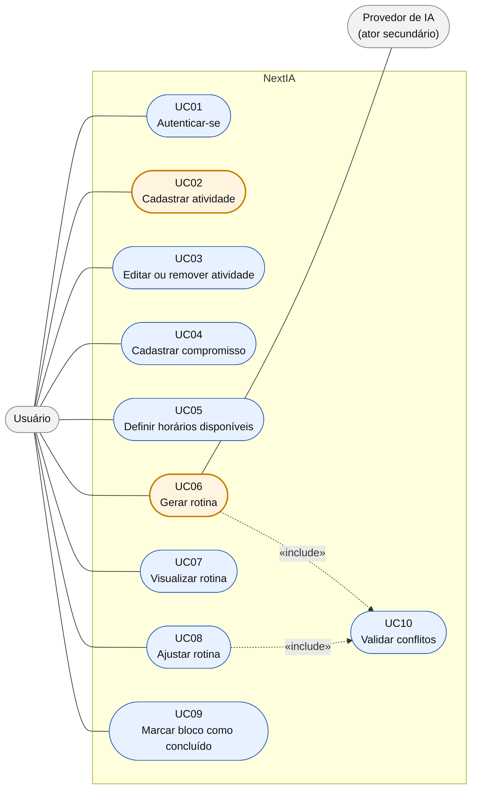

# Histórias de Usuário e Casos de Uso: NextIA

Aqui detalhamos o que o sistema precisa fazer do ponto de vista de quem vai usá-lo. O código do diagrama está em [`casos-de-uso.mmd`](./casos-de-uso.mmd).

## 1. Histórias de usuário

| Nº | História | Caso de uso |
|---|---|---|
| US01 | Como **usuário**, eu quero criar uma conta e entrar no sistema, para que minhas informações fiquem salvas e só eu tenha acesso a elas. | UC01 |
| US02 | Como **usuário**, eu quero cadastrar minhas atividades com duração, prioridade e prazo, para que a IA saiba o que eu preciso fazer. | UC02 |
| US03 | Como **usuário**, eu quero editar ou remover uma atividade, para manter minha lista atualizada quando meus planos mudarem. | UC03 |
| US04 | Como **usuário**, eu quero cadastrar meus compromissos com hora marcada, para que a rotina não coloque nada em cima deles. | UC04 |
| US05 | Como **usuário**, eu quero informar meus horários disponíveis, para que a rotina use só os momentos em que posso me dedicar. | UC05 |
| US06 | Como **usuário**, eu quero solicitar uma rotina para um período, para receber um plano pronto sem precisar montá-lo na mão. | UC06 |
| US07 | Como **usuário**, eu quero ver minha rotina em blocos de horário com a justificativa de cada um, para entender por que cada atividade ficou ali. | UC07 |
| US08 | Como **usuário**, eu quero ajustar a rotina gerada, para adaptá-la quando algo não servir ou o meu dia mudar. | UC08 |
| US09 | Como **usuário**, eu quero marcar blocos como concluídos, para acompanhar meu progresso. | UC09 |
| US10 | Como **usuário**, eu quero que a rotina nunca tenha horários conflitantes, para conseguir cumpri-la de verdade. | UC10 |

## 2. Diagrama de casos de uso

Os dois casos de uso em destaque (laranja) são os que detalhamos na próxima seção. Os atores são o **Usuário** (principal) e o **Provedor de IA** (secundário, usado só na geração da rotina). A validação de conflitos é um caso de uso incluído (`«include»`) na geração e no ajuste, já que os dois precisam dela.

## 3. Descrição textual dos dois casos de uso principais

Escolhemos **Gerar rotina**, que é o coração do sistema, e **Cadastrar atividade**, que é a principal informação que alimenta a IA.

### UC06: Gerar rotina

| Campo | Descrição |
|---|---|
| **Atores** | Usuário (principal) e Provedor de IA (secundário) |
| **Objetivo** | Criar uma rotina organizada para um período, a partir das atividades, compromissos e horários disponíveis do usuário |
| **Pré-condições** | Usuário autenticado; pelo menos uma atividade pendente; pelo menos um horário disponível cadastrado |
| **Pós-condições** | Rotina salva com status `GERADA`, com seus blocos de horário e justificativas |

**Fluxo principal**

1. O usuário solicita a geração de uma rotina e informa o período (data de início e fim).
2. O sistema confere se existem atividades pendentes e horários disponíveis.
3. O sistema reúne as atividades, os compromissos do período e os horários disponíveis.
4. O sistema monta o pedido e o envia à IA.
5. A IA devolve uma proposta de rotina.
6. O sistema interpreta a resposta e transforma a proposta em blocos de horário.
7. O sistema valida os blocos (UC10): sem sobreposição, dentro dos horários livres e respeitando os compromissos.
8. O sistema salva a rotina com status `GERADA`.
9. O sistema exibe a rotina, com a justificativa de cada bloco.

**Fluxos alternativos**

- **A1, sem atividades pendentes (passo 2):** o sistema avisa e oferece levar o usuário ao cadastro de atividades. O caso de uso termina.
- **A2, sem horários disponíveis (passo 2):** o sistema avisa e oferece levar o usuário à definição de horários. O caso de uso termina.
- **A3, período inválido (passo 1):** a data final é anterior à inicial. O sistema pede a correção e o fluxo volta ao passo 1.
- **A4, conflito detectado na validação (passo 7):** o sistema pede à IA uma nova proposta, informando o conflito (até 2 tentativas), e retoma no passo 5.
- **A5, tempo insuficiente para tudo (passo 5):** a rotina é gerada com as atividades de maior prioridade, e o sistema avisa quais ficaram de fora.

**Fluxos de exceção**

- **E1, IA indisponível ou sem resposta (passos 4 e 5):** o sistema informa o problema, não salva nada e sugere tentar novamente mais tarde.
- **E2, resposta inválida ou conflitos persistentes (passos 6 e 7):** se a resposta não pode ser interpretada, ou os conflitos continuam após as tentativas, o sistema informa o erro e não salva a rotina.
- **E3, sessão expirada:** o sistema leva o usuário de volta ao login.

### UC02: Cadastrar atividade

| Campo | Descrição |
|---|---|
| **Atores** | Usuário |
| **Objetivo** | Registrar uma atividade que o usuário precisa realizar, para que entre nas próximas rotinas |
| **Pré-condições** | Usuário autenticado |
| **Pós-condições** | Atividade salva com status `PENDENTE` e visível na lista do usuário |

**Fluxo principal**

1. O usuário escolhe cadastrar uma nova atividade.
2. O sistema exibe o formulário (título, descrição, duração estimada, prioridade e prazo).
3. O usuário preenche os dados e confirma.
4. O sistema valida os dados.
5. O sistema salva a atividade com status `PENDENTE`.
6. O sistema confirma o cadastro e exibe a atividade na lista.

**Fluxos alternativos**

- **A1, dados obrigatórios ausentes ou inválidos (passo 4):** por exemplo, título vazio ou duração menor ou igual a zero. O sistema destaca os campos com problema e o fluxo volta ao passo 3.
- **A2, prazo no passado (passo 4):** o sistema avisa e pede um prazo válido. O fluxo volta ao passo 3.
- **A3, possível duplicata (passo 4):** já existe uma atividade com o mesmo título e prazo. O sistema pergunta se o usuário quer cadastrar mesmo assim; se sim, segue o passo 5, se não, volta ao passo 3.
- **A4, usuário cancela (passos 2 e 3):** nada é salvo e o caso de uso termina.

**Fluxos de exceção**

- **E1, falha ao salvar (passo 5):** o sistema informa o erro e mantém os dados no formulário para o usuário tentar de novo.
- **E2, sessão expirada:** o sistema leva o usuário de volta ao login.