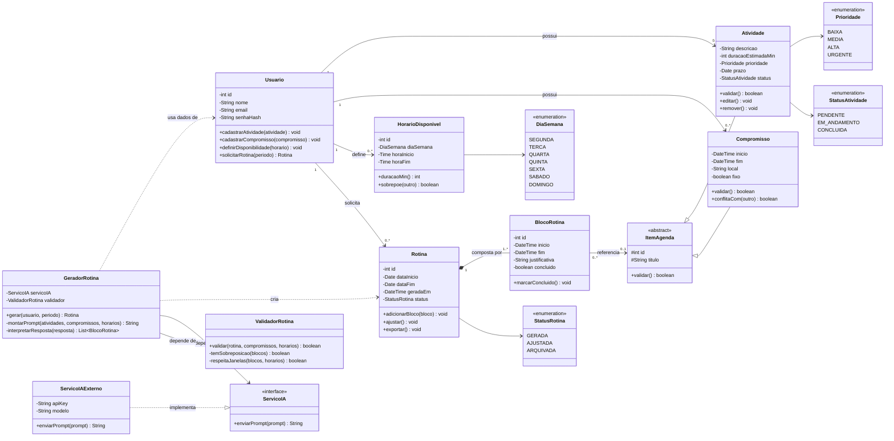

# Diagrama de Classes: Gerador de Rotina com IA

Aqui está a "planta baixa" do nosso sistema: quem são as peças e como elas se conectam. O código do diagrama está em [`diagrama-classes.mmd`](./diagrama-classes.mmd).

## A ideia em poucas palavras

O usuário conta pro sistema o que precisa fazer, o que já tem marcado e quando está livre. Com isso, a IA monta uma rotina organizada, e o sistema confere se ela não tem nenhum conflito de horário antes de entregar.

## Quem são as peças

**O que o usuário informa**
- `Usuario`: a pessoa que usa o sistema e é dona de todas as informações.
- `Atividade`: algo que ela precisa fazer, com duração, prioridade e prazo. É flexível: a IA decide onde encaixar.
- `Compromisso`: algo com hora marcada, como uma aula ou uma consulta. Esse não muda de lugar.
- `HorarioDisponivel`: as janelas em que ela pode se dedicar às atividades.

**O que o sistema entrega**
- `Rotina`: o plano completo para um período.
- `BlocoRotina`: cada pedacinho da rotina, com horário, uma justificativa do porquê está ali e se já foi concluído.

**Quem faz o trabalho nos bastidores**
- `GeradorRotina`: coordena tudo. Monta o pedido para a IA, recebe a resposta e transforma em rotina.
- `ServicoIA` e `ServicoIAExterno`: a primeira é um contrato ("alguém que sabe propor uma rotina"), a segunda é quem de fato conversa com o provedor de IA. Se um dia trocarmos de provedor, só essa segunda peça muda.
- `ValidadorRotina`: confere se a rotina gerada não tem sobreposição e respeita os horários livres.

**Enumerações** (listas fixas de opções): `Prioridade`, `StatusAtividade`, `StatusRotina` e `DiaSemana`.

## Como elas se conectam

- Um usuário tem **várias** atividades, compromissos, horários disponíveis e rotinas (ou nenhum de cada, no começo).
- Uma rotina é **composta** por um ou mais blocos. Sem a rotina, o bloco não existe.
- **Herança:** `Atividade` e `Compromisso` são tipos de `ItemAgenda`, uma classe abstrata que guarda o que os dois têm em comum (`id`, `titulo` e `validar()`). Isso permite que um bloco aponte para "um item da agenda", sem se importar se é atividade ou compromisso. Um bloco pode apontar para nenhum item, por exemplo numa pausa.
- O `GeradorRotina` depende do contrato `ServicoIA` e do `ValidadorRotina`, não de uma IA específica.

## Encapsulamento

Todos os atributos são privados. O resto do sistema só mexe neles por meio dos métodos públicos. A exceção é `ItemAgenda`, onde `id` e `titulo` são protegidos (`#`) para as subclasses poderem usá-los. Dados sensíveis, como `senhaHash` e `apiKey`, ficam privados e sem acesso de fora.

## O diagrama

## Pontos para a equipe decidir

- A prioridade de cada atividade é o usuário que define ou a IA que sugere?
- O que `Rotina.exportar()` vai exportar de fato (PDF, calendário, texto)?